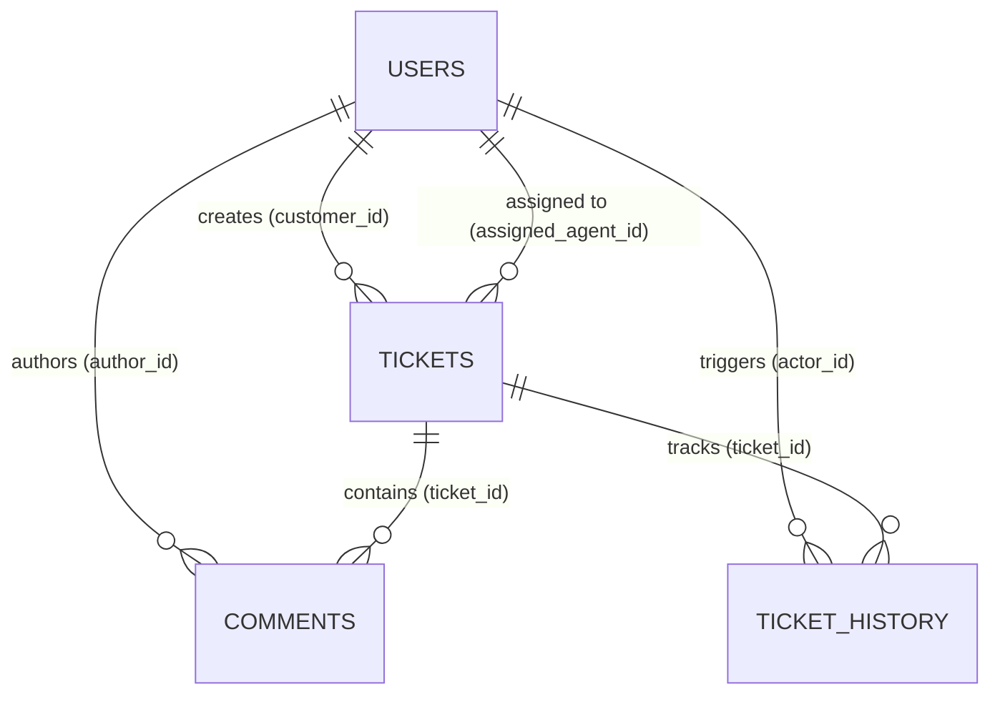

git add README.md
<<<<<<< HEAD
<<<<<<< HEAD
# 🎫 SupportDesk — Customer Support Ticket Management System

A full-stack web application designed to help organizations manage customer support requests efficiently. SupportDesk provides a centralized platform for creating tickets, tracking their progress, assigning support agents, and managing issue resolution.

Built using **Java, Spring Boot, Spring Security, JWT, Spring Data JPA, MySQL, React, and Axios**.

---

## 📌 Project Overview

SupportDesk simplifies customer support operations by replacing scattered support requests with a structured ticket management workflow.

Customers can submit issues and track their progress, support agents can investigate and resolve tickets, and administrators can manage users and oversee support operations according to their permissions.

### 🎯 Key Objectives

* Centralize customer support requests.
* Track tickets throughout their lifecycle.
* Implement secure authentication and role-based access control.
* Maintain structured and consistent relational data.
* Separate frontend, backend, and database responsibilities.
* Provide a maintainable architecture suitable for future enhancements.

---

## ✨ Features

### 👤 User Management

* User registration and login.
* JWT-based authentication.
* Role-based access control.
* Protected endpoints for authorized users.

### 🎫 Ticket Management

* Create and view support tickets.
* Track ticket status and priority.
* Assign tickets to support agents, where supported.
* Update tickets according to authorized workflows.
* Maintain ticket information in a relational database.

### 🔄 Ticket Lifecycle

The intended ticket workflow is:

`OPEN → IN_PROGRESS → RESOLVED → CLOSED`

The backend should validate status transitions according to the application's business rules.

### 💬 Comments and History

* Associate comments with support tickets.
* Track ticket updates and status changes, where implemented.
* Maintain a record of ticket activity.

### 📊 Dashboard and Ticket Organization

* View ticket information in a centralized interface.
* Search and filter tickets, where implemented.
* Display ticket statistics, where implemented.
* Organize ticket workloads by status or priority.

### 🔐 Security

* Spring Security integration.
* JWT validation for protected endpoints.
* Role-based permissions.
* Backend-side authorization checks.
* Password hashing rather than plaintext password storage.

---

## 🛠️ Technology Stack

| Technology      | Purpose                                       |
| --------------- | --------------------------------------------- |
| Java            | Backend programming language                  |
| Spring Boot     | Backend application framework                 |
| Spring Web      | REST API development                          |
| Spring Security | Authentication and authorization              |
| JWT             | Token-based authentication                    |
| Spring Data JPA | Database access                               |
| Hibernate       | Object-relational mapping                     |
| MySQL           | Relational database                           |
| Maven           | Dependency management and build automation    |
| React           | Frontend development                          |
| Vite            | Frontend development server and build tooling |
| React Router    | Frontend navigation                           |
| Axios           | HTTP requests to backend APIs                 |
| Git & GitHub    | Version control and source code management    |

---

## 🏗️ Application Architecture

SupportDesk follows a layered backend architecture with a separate React frontend.

```text
                  USER
                   |
                   v
          REACT FRONTEND
       React Router / Axios
                   |
             HTTP / JSON
                   |
                   v
          SPRING BOOT API
                   |
                   v
            SPRING SECURITY
       Authentication and Access
                   |
                   v
            CONTROLLER LAYER
       Request and Response Handling
                   |
                   v
              SERVICE LAYER
          Business Logic and Rules
                   |
                   v
            REPOSITORY LAYER
          Spring Data JPA
                   |
                   v
             HIBERNATE ORM
                   |
                   v
               MYSQL DB
```

### Backend Layers

**Controller Layer**

* Receives HTTP requests.
* Validates and processes request data at the API boundary.
* Calls the appropriate Service methods.
* Returns HTTP responses.

**Service Layer**

* Implements business logic.
* Coordinates ticket operations.
* Enforces workflow rules.
* Applies appropriate authorization and ownership checks.

**Repository Layer**

* Provides database access.
* Uses Spring Data JPA to retrieve and persist records.
* Supports standard CRUD operations and custom queries.

**Entity Layer**

* Represents persistent domain objects.
* Defines mappings between Java classes and database tables.
* Represents relationships between users, tickets, comments, and history records, as applicable.

---

## 🗄️ Database Design

The intended data model may include the following entities. Confirm the actual table and column names against your implementation.

| Entity         | Purpose                                                 |
| -------------- | ------------------------------------------------------- |
| Users          | Stores user information and roles                       |
| Tickets        | Stores ticket details, status, priority, and ownership  |
| Comments       | Stores comments associated with tickets                 |
| Ticket History | Records ticket status changes and other relevant events |

### Relationship Overview

* A customer can create multiple tickets.
* A ticket can have multiple comments.
* A ticket can have multiple history entries.
* A ticket may be assigned to a support agent.
* Comments and history entries reference their associated tickets.

JPA relationships and database constraints help maintain the consistency of related records.

---

## 🔐 Authentication and Authorization

SupportDesk uses Spring Security and JWT-based authentication in its intended security design.

### Authentication Flow

1. A user submits their login credentials.
2. The backend validates the credentials.
3. The backend issues a signed JWT if authentication succeeds.
4. The client includes the token in subsequent protected requests, according to the configured authentication mechanism.
5. The backend validates the token before processing protected operations.

### Intended User Roles

| Role     | Responsibility                                           |
| -------- | -------------------------------------------------------- |
| CUSTOMER | Create and track permitted support tickets               |
| AGENT    | Handle and resolve tickets they are authorized to manage |
| ADMIN    | Access administrative functionality                      |

Authorization must be enforced by the backend. Frontend route protection alone is not sufficient to secure application resources.

---

## 🔄 Ticket Workflow

The intended ticket lifecycle is:

```text
       CREATE TICKET
             |
             v
           OPEN
             |
             v
        IN_PROGRESS
             |
             v
          RESOLVED
             |
             v
           CLOSED
```

### Workflow Description

1. A customer submits a support request.
2. The backend validates the request and creates the ticket.
3. The ticket begins in the appropriate initial state.
4. An authorized user assigns or processes the ticket.
5. An authorized agent investigates the issue.
6. The agent updates the status according to the permitted workflow.
7. The ticket is resolved and may subsequently be closed.

The exact transitions depend on the implemented business rules.

---

## 🔌 API Overview

The following routes are illustrative examples of a possible API design. Replace them with the actual endpoints implemented in your application.

| Method | Example Endpoint             | Purpose                     |
| ------ | ---------------------------- | --------------------------- |
| POST   | `/api/auth/register`         | Register a user             |
| POST   | `/api/auth/login`            | Authenticate a user         |
| GET    | `/api/tickets`               | Retrieve permitted tickets  |
| POST   | `/api/tickets`               | Create a ticket             |
| GET    | `/api/tickets/{id}`          | Retrieve a permitted ticket |
| PATCH  | `/api/tickets/{id}/status`   | Update ticket status        |
| POST   | `/api/tickets/{id}/comments` | Add a ticket comment        |

Protected endpoints require the configured authentication mechanism and appropriate permissions.

---

## ⚙️ Prerequisites

Install the following tools before running the application:

* Java JDK compatible with the project's configured version.
* Maven, or the project's Maven Wrapper.
* MySQL Server.
* Node.js and npm.
* Git.

Check your installed versions:

```bash
java -version
mvn -version
node -v
npm -v
git --version
```

---

## 🚀 Getting Started

### 1. Clone the Repository

```bash
git clone <YOUR_GITHUB_REPOSITORY_URL>
cd <YOUR_PROJECT_DIRECTORY>
```

Replace the placeholders with your actual repository URL and project directory.

### 2. Configure MySQL

Create the application database:

```sql
CREATE DATABASE supportdesk;
```

Use the database name expected by your application.

### 3. Configure Backend Environment

Configure the database connection and other required application properties.

For example, your local Spring Boot configuration may use:

```properties
spring.datasource.url=${DB_URL:jdbc:mysql://localhost:3306/supportdesk}
spring.datasource.username=${DB_USERNAME:root}
spring.datasource.password=${DB_PASSWORD}

spring.jpa.hibernate.ddl-auto=update
```

This is an illustrative configuration. Adapt it to your existing `application.properties` or `application.yml`.

For a production deployment, use controlled database migrations rather than relying on automatic schema updates.

Configure the JWT secret through a secure environment variable or secret manager. Never commit real credentials or production secrets to GitHub.

### 4. Start the Backend

From the backend project directory, run:

```bash
mvn spring-boot:run
```

Alternatively, if the project includes Maven Wrapper:

**Windows**

```powershell
.\mvnw.cmd spring-boot:run
```

**Linux/macOS**

```bash
./mvnw spring-boot:run
```

The default Spring Boot port is commonly `8080`, unless configured otherwise.

### 5. Start the Frontend

Open another terminal and navigate to the React frontend directory:

```bash
cd <YOUR_FRONTEND_DIRECTORY>
npm install
npm run dev
```

Vite commonly serves the development application at:

```text
http://localhost:5173
```

Use the actual URL printed by your terminal.

### 6. Configure API Connectivity

Ensure that the frontend's API base URL points to the running backend.

If the frontend and backend use different origins, configure backend CORS rules to allow the intended frontend origin.

---

## 🧪 Testing

Testing should cover the application's main workflows and security rules.

Recommended test scenarios include:

* Successful and unsuccessful login.
* User registration and duplicate-email handling.
* Ticket creation and retrieval.
* Ticket status transitions.
* Ticket assignment and comment creation.
* Unauthorized access to protected endpoints.
* Ticket ownership validation.
* Database persistence and retrieval.
* Frontend and backend integration.

### Testing Tools

Potential tools include:

* JUnit for Java unit tests.
* Mockito for mocking dependencies.
* Spring Boot Test for application testing.
* Postman for API testing.
* Browser developer tools for frontend debugging.

Document the tests actually performed and the tools actually used.

---

## 🔒 Security Considerations

* Store password hashes rather than plaintext passwords.
* Validate JWT signatures and expiration.
* Keep signing secrets and database credentials out of source control.
* Enforce authorization on the backend.
* Check ticket ownership before exposing or modifying ticket data.
* Validate request data.
* Use HTTPS in production.
* Avoid exposing internal stack traces or sensitive information in API error responses.
* Apply appropriate database constraints.
* Use secure configuration and controlled database migrations in production.

---

## 📈 Future Enhancements

Potential improvements include:

* Email notifications for ticket updates.
* File attachments for customer issues.
* Ticket escalation and service-level agreement tracking.
* Advanced dashboard analytics.
* Improved audit logging.
* Automated integration and end-to-end tests.
* Docker-based development and deployment.
* Cloud deployment with centralized monitoring.
* Password reset and account recovery.
* Search optimization for large ticket volumes.

These are possible future enhancements, not claims that the features already exist.

---

## 🎓 Learning Outcomes

This project provides practical experience with:

* Full-stack web application development.
* Java and Spring Boot.
* REST API design and integration.
* Controller-Service-Repository architecture.
* Spring Security and JWT.
* Role-based authorization.
* Relational database design.
* JPA entity relationships.
* Business workflow implementation.
* API testing and debugging.
* Frontend and backend integration.

---

## 👨‍💻 Author

**Dharenesh**

B.Tech — Artificial Intelligence and Data Science

Project: Customer Support Ticket Management System
=======
# SupportDesk - Customer Support Ticket Management System
=======
# SupportDesk — Enterprise Customer Support Ticket Management Platform
>>>>>>> cc4e73c (docs: enhance README with architecture badges and GitHub setup instructions)

[](https://www.oracle.com/java/)
[](https://spring.io/projects/spring-boot)
[](https://react.dev/)
[](https://www.mysql.com/)
[](LICENSE)
[](https://www.docker.com/)

**SupportDesk** is a production-oriented, full-stack customer support and ticketing platform built as a clean modular monolith. It provides customer self-service ticket filing, support agent workload queue management, and executive administrative oversight with strict Role-Based Access Control (RBAC), database transaction atomicity, and an immutable audit trail.

---

## Architecture Overview

```
[React 19 SPA (Vite / Nginx)]
      │
      ▼  (HTTP / JSON with JWT Bearer Token)
[Spring Boot 3 REST Controllers] (/api/auth, /api/tickets, /api/agent, /api/admin)
      │
      ▼
[Spring Security 6 Filter Chain] (JwtAuthenticationFilter & CustomUserDetailsService)
      │
      ▼
[Service Layer] (Business Rules, Ownership Isolation, State Machine Guards)
      │
      ├──────────────────────────────┐
      ▼                              ▼
[Audit History Service]      [Spring Data JPA Repositories]
(Atomic audit log)                   │
                                     ▼
                          [Hibernate 6 ORM Layer]
                                     │
                                     ▼
                          [MySQL 8.0 Relational DB]
                          (Managed via Flyway Migrations)
```

---

## Key Features

- **Public Customer Registration & Secure Auth**: Public signup strictly provisions `ROLE_CUSTOMER` (preventing privilege escalation). Passwords are encrypted with BCrypt ($2a$). Stateless JWT tokens are signed using HMAC-SHA256.
- **Automated Admin Bootstrap Seeding**: On cold database startup, the backend automatically seeds a system administrator using environment variables.
- **State Machine Ticket Lifecycle**:
  - `OPEN` &rarr; `IN_PROGRESS` (Agent claim or Admin assignment)
  - `IN_PROGRESS` &rarr; `RESOLVED` (Assigned agent or Administrator)
  - `RESOLVED` &rarr; `CLOSED` (Terminal state)
  - Reopening is restricted to administrators. Closed tickets are strictly immutable.
- **Real-Time Conversations & Staff Internal Notes**: Discussion thread between customers and support engineers. Staff can mark comments as `internalNote`, which is filtered at the database level and hidden from customer accounts.
- **Atomic Audit Trail**: Immutable history log tracking previous values, new values, actors, and timestamps within the same database transaction.
- **Role-Aware Dashboards**:
  - **Customer Portal**: Track active inquiries, status badges, and submit new tickets.
  - **Agent Workstation**: View personal workload, monitor unassigned tickets, and claim tickets with one click.
  - **Executive Admin Dashboard**: Real-time data visualizations with Recharts (status donut chart, priority distribution bar chart), agent capacity utilization, and user access management.
- **Safe Server-Side Search, Filtering, & Pagination**: Filter by status, priority, category, or agent with allowlisted sorting keys.

---

## Tech Stack

| Layer | Technologies |
|---|---|
| **Backend** | Java 21, Spring Boot 3.3.4, Spring Security 6, Spring Data JPA, Hibernate 6, JJWT 0.12.6, Flyway 10, JUnit 5, Mockito |
| **Frontend** | React 19, Vite 8, React Router 7, Axios, Recharts 3, Lucide React icons |
| **Database** | MySQL 8.0 (InnoDB, UTF-8 Unicode) |
| **DevOps** | Docker, Docker Compose, Nginx (reverse proxy & SPA router) |

---

## Getting Started

### Prerequisites
- **Java 21 JDK** (Eclipse Temurin or OpenJDK)
- **Maven 3.9+**
- **Node.js 20+** and **npm 10+**
- **MySQL 8.0** running locally on port `3306`

---

### Option 1: Run with Docker Compose (Fastest)

Make sure Docker Desktop is running:
```bash
docker compose up --build
```
- **Web Application**: `http://localhost`
- **Backend API**: `http://localhost:8080/api`
- **Health Check**: `http://localhost:8080/api/health`

---

### Option 2: Run Locally (Windows PowerShell)

#### 1. Setup MySQL Database
```powershell
mysql -u root -p -e "CREATE DATABASE IF NOT EXISTS supportdesk_db;"
```

#### 2. Start the Backend (Terminal 1)
```powershell
cd backend
$env:JAVA_HOME = "C:\Users\<username>\.jdks\temurin-21.0.12"  # Adjust if needed
mvn clean spring-boot:run
```
*Or run the pre-built JAR:*
```powershell
java -jar target/supportdesk-backend-1.0.0.jar
```
*The Spring Boot backend will start on `http://localhost:8080`. Flyway will run migrations and seed the initial administrator.*

#### 3. Start the Frontend (Terminal 2)
```powershell
cd frontend
npm install
npm run dev
```
*The React application will be available at `http://localhost:5173`.*

---

## Demo Credentials

You can immediately log in with the following seeded roles:

| Role | Email | Password | Scope |
|---|---|---|---|
| **Administrator** | `admin@supportdesk.com` | `Admin@SupportDesk2026!` | Full oversight, analytics, assignment, agent management |
| **Support Agent** | `david.agent@supportdesk.com` | `AgentPassword123!` | Assigned workload, claim unassigned tickets, post staff notes |
| **Customer** | `sarah@gmail.com` | `Password123!` | Submit tickets, view own tickets, reply in conversation |

*(You can also click **"Create one"** on the login page to register brand new customer accounts).*

---

## Database Design & ER Diagram



- **`users`**: User accounts, BCrypt passwords, role permissions (`ROLE_ADMIN`, `ROLE_AGENT`, `ROLE_CUSTOMER`), and active/inactive status.
- **`tickets`**: Support tickets with unique ticket reference number (`TCK-xxx`), status, priority, and category.
- **`comments`**: Public customer replies and private staff diagnostic notes.
- **`ticket_history`**: Audit trail capturing action type, actor ID, previous/new value, and timestamps.

---

## REST API Endpoints

| Method | Endpoint | Required Role | Description |
|---|---|---|---|
| `POST` | `/api/auth/register` | Public | Register customer account (auto-issues JWT) |
| `POST` | `/api/auth/login` | Public | Authenticate user & return JWT token |
| `GET` | `/api/auth/me` | Authenticated | Retrieve current user profile |
| `POST` | `/api/tickets` | `ROLE_CUSTOMER` | Create support ticket |
| `GET` | `/api/tickets/my` | `ROLE_CUSTOMER` | Paginated search of customer's own tickets |
| `GET` | `/api/tickets/my/dashboard` | `ROLE_CUSTOMER` | Customer status counts & recent tickets |
| `GET` | `/api/tickets/{id}` | Authenticated | View ticket details (ownership guarded) |
| `POST` | `/api/tickets/{id}/comments`| Authenticated | Post comment (checks customer/agent eligibility) |
| `GET` | `/api/tickets/{id}/comments` | Authenticated | List comments (strips internal notes for customers) |
| `GET` | `/api/tickets/{id}/history` | Authenticated | View audit trail (ownership guarded) |
| `GET` | `/api/agent/tickets` | `ROLE_AGENT`, `ADMIN` | List tickets assigned to agent |
| `GET` | `/api/agent/tickets/unassigned` | `ROLE_AGENT`, `ADMIN` | List unassigned queue tickets |
| `POST` | `/api/agent/tickets/{id}/claim` | `ROLE_AGENT`, `ADMIN` | Claim unassigned ticket into active queue |
| `PATCH`| `/api/agent/tickets/{id}/status` | `ROLE_AGENT`, `ADMIN` | Transition ticket status (`IN_PROGRESS` &rarr; `RESOLVED`) |
| `GET` | `/api/admin/tickets` | `ROLE_ADMIN` | View and filter all system tickets |
| `PATCH`| `/api/admin/tickets/{id}/assign` | `ROLE_ADMIN` | Assign or reassign ticket to an agent |
| `PATCH`| `/api/admin/tickets/{id}/status` | `ROLE_ADMIN` | Admin status override (close / reopen) |
| `GET` | `/api/admin/dashboard` | `ROLE_ADMIN` | Executive metrics, charts data, workload capacity |
| `GET` | `/api/admin/users` | `ROLE_ADMIN` | List all system users |
| `POST` | `/api/admin/users/agents` | `ROLE_ADMIN` | Provision new agent account |
| `PATCH`| `/api/admin/users/{id}/active` | `ROLE_ADMIN` | Toggle user active/inactive status |

---

## Automated Tests

Run backend unit and integration test suite:
```powershell
cd backend
mvn test
```
*Executes tests against an isolated, in-memory H2 database in MySQL compatibility mode.*

Verify production frontend build:
```powershell
cd frontend
npm run build
```

---

## Git & GitHub Push Instructions

To push this codebase to your own GitHub repository:

1. Create a new repository on [GitHub](https://github.com/new) called **`SupportDesk`**.
2. Run the following commands in your project root terminal:

```bash
# Link your remote repository
git remote add origin https://github.com/<YOUR_GITHUB_USERNAME>/SupportDesk.git

# Set default branch to main and push
git branch -M main
git push -u origin main
```

---

<<<<<<< HEAD
## 7. Documentation
- [System Architecture & Workflow](docs/architecture.md)
- [REST API Specifications](docs/api-documentation.md)
- [Database Schema & Migrations](docs/database-design.md)
>>>>>>> 3001841 (feat: complete initial implementation of SupportDesk fullstack system)
=======
## License

This project is licensed under the [MIT License](LICENSE).
>>>>>>> cc4e73c (docs: enhance README with architecture badges and GitHub setup instructions)
