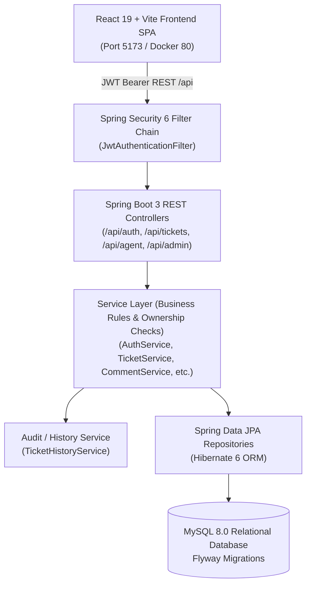

# SupportDesk Architecture & System Design

SupportDesk is a modern, modular monolith Customer Support Ticket Management Platform built for high reliability, strict role-based authorization, comprehensive auditability, and clear separation of concerns.

---

## 1. High-Level Architecture Overview

---

## 2. Key Modules & Responsibilities

1. **Authentication & Security (`com.supportdesk.backend.security`, `auth`)**
   - Implements stateless JWT authentication using `io.jsonwebtoken` (JJWT 0.12.x).
   - Validates tokens per request in `JwtAuthenticationFilter` and registers authorities in Spring Security's `SecurityContextHolder`.
   - Protects against privilege escalation: public registration strictly provisions `ROLE_CUSTOMER`.
   - Implements automated initial bootstrap seeding (`AdminBootstrapRunner`) for the first administrator account if no admin is detected in the database.

2. **Ticket Workflow & Ownership (`com.supportdesk.backend.ticket`)**
   - Strictly enforces status transition rules (`TicketStatus.canTransitionTo()`):
     - `OPEN` &rarr; `IN_PROGRESS` (Agent claim or Admin assign)
     - `IN_PROGRESS` &rarr; `RESOLVED` (Handled by assigned Agent or Admin)
     - `RESOLVED` &rarr; `CLOSED` (Terminal state)
     - Only an Administrator can reopen a `RESOLVED` ticket back to `IN_PROGRESS`.
   - Prevents unauthorized access: customers can only view and comment on their own tickets; agents can view their workload and claim open tickets; admins have global oversight.

3. **Comments & Internal Notes (`com.supportdesk.backend.comment`)**
   - Supports customer conversations and staff-only internal notes.
   - Internal notes (`internalNote: true`) are filtered at the repository/service layer and hidden from customers.

4. **Audit History (`com.supportdesk.backend.history`)**
   - Automatically records actions (`CREATED`, `ASSIGNED`, `STATUS_CHANGE`, `CLAIMED`, `UPDATED`) within the same database transaction.
   - Captures actor ID, action type, previous value, new value, and timestamp.

5. **Frontend Single-Page Application (`frontend/`)**
   - Built with React 19, Vite, and React Router 7.
   - Role-aware navigation and client-side guards (`ProtectedRoute`).
   - Axios request interceptor attaches JWT bearer headers automatically; response interceptor transparently clears invalid tokens and redirects on 401.
   - Interactive charts and visualizations powered by Recharts.
