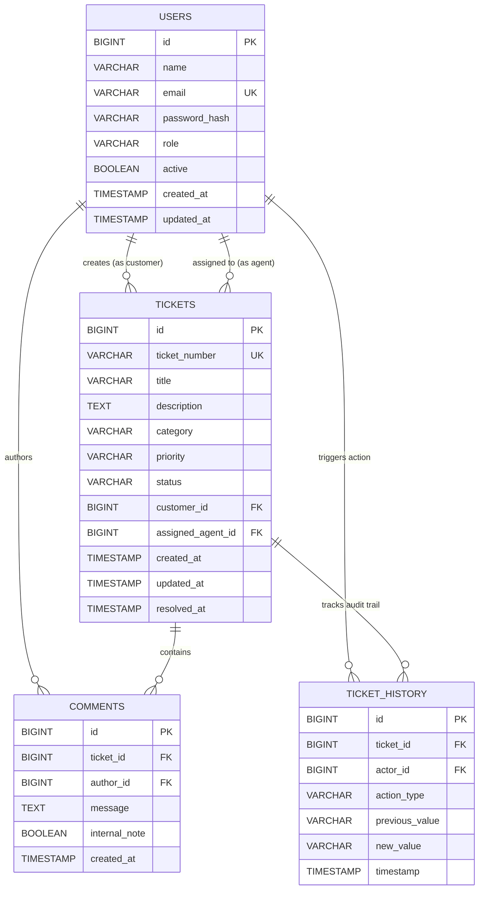

# SupportDesk Database Schema & Design

SupportDesk uses MySQL 8.x for its relational persistence layer. All schema creation and evolution is managed via Flyway versioned migrations located in `database/migrations/` and mirrored in the backend resources classpath `db/migration/`.

---

## 1. Entity-Relationship Diagram

---

## 2. Table Specifications

### 2.1 `users`
- Stores accounts across the three defined roles (`ROLE_ADMIN`, `ROLE_AGENT`, `ROLE_CUSTOMER`).
- Passwords are encrypted using BCrypt ($2a$). Plaintext passwords are never persisted.
- **Indexes:**
  - `idx_users_email` (Unique lookup by email during authentication)
  - `idx_users_role` (Querying agents for assignment queues)

### 2.2 `tickets`
- Stores all customer support issues with human-readable identifiers (e.g. `TCK-1791784925737-194`).
- **Foreign Keys:**
  - `fk_tickets_customer`: Links to `users(id)` with `ON DELETE RESTRICT` to preserve data integrity.
  - `fk_tickets_agent`: Links to `users(id)` with `ON DELETE SET NULL` allowing ticket reassignment.
- **Indexes:**
  - `idx_tickets_ticket_number` (Fast lookup by reference number)
  - `idx_tickets_customer` (Customer portal queries)
  - `idx_tickets_agent` (Agent workload queries)
  - `idx_tickets_status` & `idx_tickets_priority` (Dashboard metrics and filters)
  - `idx_tickets_created_at` (Timeline sorting and pagination)

### 2.3 `comments`
- Stores discussion responses between customers and agents.
- `internal_note` boolean allows support agents and admins to leave private diagnostic notes invisible to customer accounts.
- **Foreign Keys:** `ticket_id` (Cascades on ticket deletion), `author_id` (`RESTRICT`).

### 2.4 `ticket_history`
- Immutable append-only audit trail capturing key lifecycle transitions:
  - `CREATED`, `ASSIGNED`, `REASSIGNED`, `STATUS_CHANGE`, `CLAIMED`, `UPDATED`.
- Guaranteed atomicity: recorded within the same `@Transactional` boundary as ticket modifications.

---

## 3. Migration History
- `V1__initial_schema.sql`: Initial DDL script configuring all tables, primary keys, foreign key constraints, UTF8MB4 collation, and performance indexes.
